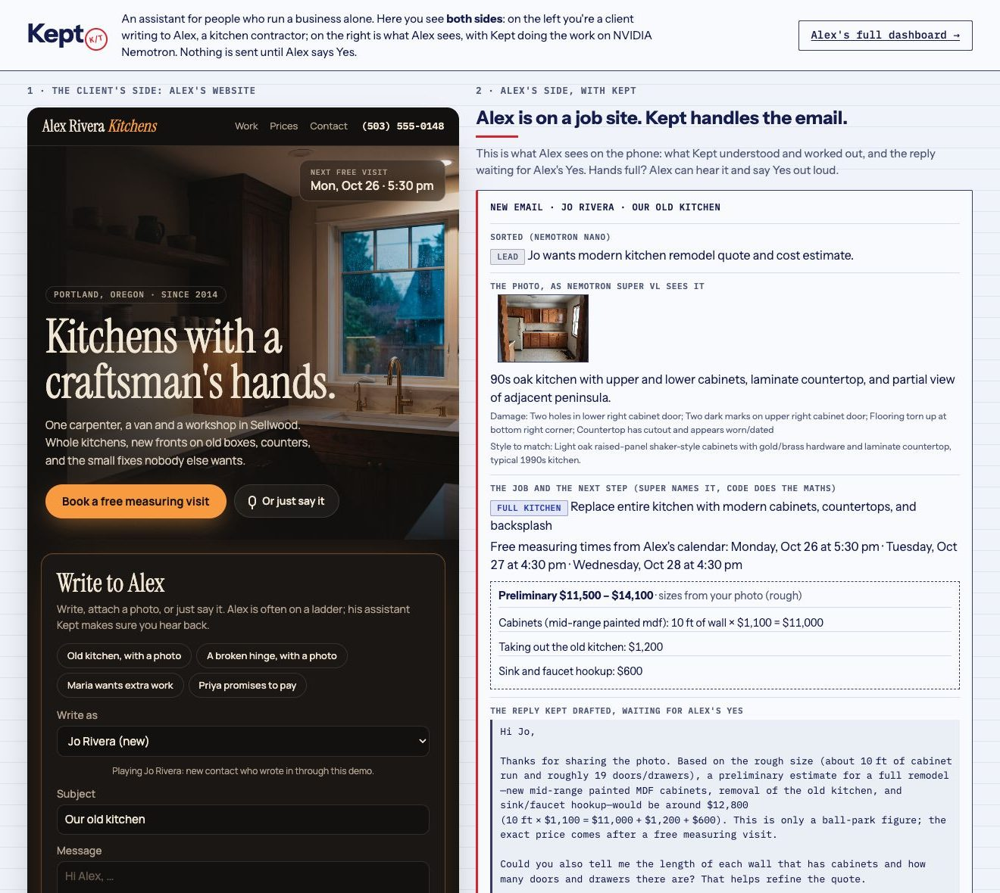

# Kept

**An always-on operator for one-person businesses. It remembers every promise you make,
checks its own work, and does nothing that reaches another person until you say Yes.**

Built for the Nebius × NVIDIA Global AI Hackathon, Personal AI track.
Runs on **Nebius Token Factory** with **NVIDIA Nemotron**: Nemotron 3 Nano, Super and Ultra, and
Nemotron 3.5 Super VL for photos, each routed to the work it's right for.

**Try it:** https://kept-operator.netlify.app (wakes the free server, then opens the demo) ·
**Video (3 min):** https://youtu.be/QisO-J2thng



The demo follows Alex, a one-person kitchen contractor in Portland (made up). On the left you're a
client on Alex's own website: write, attach a photo of your kitchen, or just say it. On the right is
Alex's phone: what Nemotron saw in the photo, the job, a preliminary estimate worked out by code from
Alex's price guide, free measuring times from his calendar, and the reply, waiting for Alex's **Yes**
(press it, or say "yes, send it"). Alex's full dashboard is one click away.

**Measured on the live models, graded by code:** 40 messages contractors really get (kitchen jobs,
other trades, four languages, off-topic chat, rudeness, haggling, an attempt to override the rules,
returning clients), 3 runs in a row, 120 / 120 right and 404 / 404 checks; Alex's whole morning,
51 runs, 1419 / 1420 checks (the one miss became a fix); 167 unit and regression tests.

---

## A personal AI, in the track's own words

| Personal AI asks for | In Kept |
|---|---|
| always-on | sorts new mail every hour; runs the whole morning (promises, money, offers, the brief) before the owner is up |
| private, data under your control | plain files on your own server; Token Factory with zero data retention; nothing leaves without your Yes |
| persistent memory | the promise ledger (both ways), a daily journal, how late you and each client really are, the calendar |
| reusable skills | `skills/*.md` rule sheets the owner can edit; rules Kept learns go into the owner's own copy after a Yes |
| tools and information you choose | the inbox, the calendar, the money book, the price guide in `notes.md`, Tavily Search and Extract |
| carries out tasks | drafts replies, prices jobs, books measuring visits, chases invoices, plans a cash rescue |

**The model never decides a price, a date, or who gets an email.** The full list is in
[CONSTITUTION.md](CONSTITUTION.md).

## Why this exists

If you work alone, your business runs on promises. "I'll send the quote by Thursday." "Let me
check and get back to you." Each one is small. Together they decide whether clients trust you.
They also live in five places at once: the inbox, a notes app, a sticky note, your head.

Two lessons from running a small business with AI assistants shaped Kept:

1. **An assistant that sometimes invents things is worse than none.** You stop trusting it, and
   then you check everything twice.
2. **An assistant that acts behind your back gets switched off.** You only hand over the keys
   when you know nothing leaves without your say-so.

So Kept is built around restraint: it proposes, code verifies, and when a check fails it holds
back and tells you why.

## What it does every morning

Kept reads the inbox and runs nine skills. Each one ends in a proposal waiting for your Yes, a
line in the morning brief, or an entry under **Held back** saying what it refused to do and why.

**Your word**
1. **Promise ledger, both ways**: what you owe and what you're owed, each with the exact words
   from the email (Nemotron Super extracts, code checks the quote).
2. **Calibration** from your closed promises, and **Before you send**: paste a reply, Kept finds
   the promise (Nano), works out the date in code and suggests the day you'll actually hit.
3. **Rules it learns** (Ultra proposes a pattern; code recounts every match; needs 4+ matches and
   60% late; you approve; it's appended to the skill file).

**Your time**
4. **Scope guard**: Ultra reads the signed agreement twice (two temperatures); disagreement means
   "unclear". Extra work is priced by code from your hourly rate.
5. **Overload call**: when promises exceed hours, Ultra picks the one deadline that can move and
   drafts an honest note. Hard deadlines are never moved.

**Your money**
6. **Cash guard**: 30-day forecast using each client's usual payment delay; reminder ladder
   (friendly, firm, final) checked for the right invoice number and amount.
7. **Rescue plan**: when the forecast goes below zero, what closes the gap fastest from your own
   pipeline, plus new local prospects found with Tavily (the page must name the business).
8. **Well-timed offers**: a calendar computed by code, your own limits from `notes.md` (max
   discount, minimum price, one offer per 60 days); nobody who owes you or whom you owe work.
9. **Growth without spam**: a review ask when a client is delighted (never while a project is
   unpaid or your last delivery was late), and a before/after post using only sourced numbers.

Plus **topic watch** (Tavily, grounded quotes only), **check-ins** with past clients a month after a
small job, an **ad plan** for a slow month inside the owner's own budget, and **Ask Kept** about your
own week.

**Answering someone who writes in, with a photo.** Nemotron 3.5 Super VL reads the photo (the room,
the damage, the style to match, rough sizes). Super names the job the way the owner works (small
repair, new fronts, countertop, backsplash, full kitchen). Code prices a small repair on the spot,
works out a preliminary estimate for bigger jobs from sizes × the price guide in `notes.md`, offers
free measuring times from the calendar, books the one the client picks, and offers a payment plan
computed from the same estimate when the client says it's too much (`kept/intake.py`,
`kept/estimate.py`, `kept/schedule.py`, `kept/vision.py`).

**Asking, remembering, staying on topic.** The reply asks only for what's missing, at most two
things (rough sizes, photos from two or three angles, the part of town, the timing). A returning
client is recognised from Alex's records (when they first wrote, about what, the estimate, a visit
booked) and the reply picks up where they left off; a familiar name from a new address is shown to
Alex and never merged on its own. A lead who went quiet for a week after an estimate gets one gentle
check-in, on Yes (`kept/followups.py`). Off-topic chat and other trades (a running toilet, a roof)
get a short, honest answer with no prices or visit times; people Alex already deals with never do.

**Talk to Kept.** Alex is up a ladder, so voice works both ways (`kept/voice.py`). A client can say
the message instead of typing it. Alex taps "Read it to me", hears the draft and says "yes, send it".
Whether that was a Yes is decided by code from the words, never by a model: "yes, but...", "don't send
it" or mumbling sends nothing and Kept asks again, and a spoken No only holds the draft. Free speech
("so what am I doing today?") is sorted by Nemotron Nano into a fixed set of things Kept can read out;
questions about the week get the same quote-checked answers as typing. The browser does the speech
(Web Speech API); Nemotron does the meaning.

**Answering someone who writes in.** A new email is sorted, checked against the agreement, its
promises recorded, and, for a stranger, the business is looked up on the web (Tavily Search, and
Tavily Extract on their own site) while the email is read. Super then drafts Alex's reply from facts
code gathered: the thread so far, Alex's rate, scope prices, unpaid invoices, open promises both ways.
Code checks the reply (the right name; only prices from Alex's records, this estimate or their own
email; every visit time named is one the calendar offered; the reply is in the client's language;
weekdays match their dates; no written quote promised by a date before the visit; a date later than
the one the client asked for is said out loud) and runs every promised date through Before you send. The reply waits for Yes; the conversation continues from there.

## Propose, verify, or abstain

| Model output | Checked by code | If the check fails |
|---|---|---|
| Promise found in an email | the quoted words must appear in that email; due date must parse and be plausible | not added; reason shown under **Held back** |
| Follow-up draft | JSON shape; no `[Name]`-style holes; mentions the person; length limit | no approval request; reason shown |
| News fact | must quote a page returned by the search, word for word | dropped; counted as "couldn't verify" |
| Morning brief | every reference must exist; every overdue promise must be mentioned | bad references removed; missing promises added by rule |
| "Move this deadline" decision | must pick one of this week's promises; new date sane; real email address | no request; reason shown |
| Answer about your week | every quote must appear in the cited ledger row or journal | shown as **Not verified** |
| Reply to a client | prices, visit times, language, weekdays, deadlines, off-topic promises (see above) | retried twice with the checks' own words, then held back |
| A spoken "yes" | read by code from the words; anything mixed or unclear | nothing is sent; Kept asks again |
| A business behind a stranger's email | looked up only if the email itself names it; facts must quote a page that names it | no lookup, or the fact is dropped |

None of these checks ask a model whether it did well. They are plain code (`kept/validators.py`),
and the tests in `tests/` show each one catching a bad output.

## The approval gate is code, not a prompt

`kept/approvals.py` keeps a registry of actions. Anything that leaves the machine (today:
`send_email`) is registered as needing approval, and the only way to run it is `execute()`,
which refuses anything that isn't approved. The model can propose whatever it likes; it has no
path to run it. Decisions come from the web dashboard or, optionally, from Yes / No buttons in
your own Telegram bot.

In demo mode, approved mail is written to `data/outbox/` instead of being sent, so anyone can
press Yes safely.

## How Kept uses Nebius Token Factory and Nemotron

Every call goes to Token Factory's OpenAI-compatible endpoint
(`https://api.tokenfactory.nebius.com/v1/`). The router (`kept/llm.py`) picks the model by the
kind of work, and every call is logged with its tier, reason, tokens, latency and cost:

| Work | Tier | Why |
|---|---|---|
| sorting mail, spotting promises in a draft | **Nemotron 3 Nano** (reasoning off) | cheap and fast; runs on every email |
| extracting promises, planning the day, drafting, summarising news | **Nemotron 3 Super** | someone will read it, so quality matters |
| scope, overload, learned rules, rescue ranking, offers | **Nemotron 3 Ultra** | rare, and a wrong call costs trust or money |
| reading a client's photo | **Nemotron 3.5 Super VL** (reasoning off) | the room, the damage, the style to match, rough sizes; about 8 s |
| sorting free speech to Kept | **Nemotron 3 Nano** | picks what to read out; it can never approve anything |

Model IDs are discovered from `/v1/models` at start-up. A daily budget (default $1.00) stops
calls before they happen once it's reached.

A full demo morning is 46-59 calls and costs $0.065-0.11 (median $0.077), measured over dozens of runs
by `eval/run_eval.py` on the live models. Answering one client email with a photo takes 15-35 seconds
and costs under a cent.

## Memory you can read

Everything Kept knows is in plain files under `data/`:

- `ledger.json`: every promise, open or closed, with who it's owed to and how it ended
- `journal/YYYY-MM-DD.md`: what Kept did and decided each day
- `notes.md`: facts about you and your business, plus the topics to watch
- `audit.jsonl`: every model call and every action

Closing a promise needs a resolution (`done`, `dropped`, `handed_off`) and a note. "Forgot" is
not a state.

## Skills you can edit

`skills/*.md` are short rule sheets (how to sort mail, how to write a follow-up, what counts as
a promise, how the brief is laid out). They are added to the prompts that use them. Change the
markdown, and Kept's behaviour changes with it, without touching code.

## Run it

```bash
cp .env.example .env          # add NEBIUS_API_KEY (and TAVILY_API_KEY for the web lookups)
python -m venv .venv && .venv/bin/pip install -r requirements.txt
.venv/bin/uvicorn kept.web:app --port 8000
# http://localhost:8000            both sides: write to Alex as a client, answer as Alex
# http://localhost:8000/dashboard  Alex's dashboard; press "Run morning loop" for a live morning
```

Or with Docker: `docker build -t kept . && docker run -p 8000:8000 -e NEBIUS_API_KEY=... kept`.

The morning loop runs its independent parts in parallel (the emails, then follow-ups, money,
rescue, growth, offers and news side by side, then the overload call and the brief); writes to the
shared files are serialised, and the one-message-per-person rule is enforced atomically. A full
demo morning takes one to two and a half minutes.

Demo mode (`KEPT_DEMO=1`, the default) opens on a recorded live morning (`demo_snapshot/`, dates
moved forward by whole weeks) and lets a visitor write to Alex as a client. It loads a made-up week for Alex, a one-person kitchen contractor
in Portland: nine emails, two signed agreements, a calendar, a money book, a price guide and eight
weeks of history. Sample photos (`demo_media/`) were generated for the demo.
Tests: `.venv/bin/python -m pytest -q` (167). Live evaluation on Nemotron (costs model credits, about
$0.10 a run), every check written in code:

```bash
.venv/bin/python eval/run_eval.py --runs 5        # Alex's whole morning, 30 checks per run
.venv/bin/python eval/run_clients.py --runs 3     # Jo's kitchen from photo to booked visit, Maria, Priya
.venv/bin/python eval/run_messages.py             # 40 real-world client messages (eval/messages.json)
```

## What live testing taught us

Our first runs on the real models went badly, and we kept the evidence because it shaped the design:

- **Every email got held back.** Nemotron Nano spent its whole token budget reasoning and returned an
  empty answer. Kept didn't guess; it logged "model reply unusable" for each one. Fix: Nano runs with
  reasoning switched off, Super and Ultra get extra room to think.
- **A promise was "owed to" the owner.** The model filled in the owner's name as the person waiting,
  so the follow-up started "Hi Alex" (that's the sender) and promised a date that had already passed.
  Fix: who the promise is owed to and their address now come from the email header, by code; a new
  check holds back drafts that greet the sender or mention a past date.
- **Ultra emailed an address it made up.** Fix: Ultra picks *which* promise to move; the address
  always comes from the original email.
- **Ultra told an accountant a delay "has no impact on your filing".** It only saw a one-line title.
  Fix: Ultra now reads each person's own words, and is told never to move someone's hard deadline.
  Its next decision moved the only promise without one, and its reasoning is saved next to it.
- **Two contradicting emails waited for approval** ("it's coming today" and "can we move it to
  Monday?"). Fix: a promise that already has a message waiting is off-limits to other jobs.

- **A homeowner became a shop.** Jo wrote from jo@riverahome.example; the model read "Rivera Home" into
  the address, Tavily found a real store by that name, and Jo got no estimate. Fix: a business is looked
  up only if the email itself names it.
- **Alex's accountant was told "I specialize in kitchens".** The off-topic rule saw no kitchen words.
  Fix: only possible new clients can be off-topic; anyone in Alex's promises, invoices or contracts gets
  a real answer.
- **A passed date slipped through.** The model wrote "October\u202f23" with a narrow no-break space and
  the date check looked for an ordinary one. Fix: every check reads plain spaces first.

Each of these has a regression test in `tests/`.

## Limitations (honest list)

- It only knows what's in the inbox and its own files. Promises made on a phone call don't exist
  until you add them.
- The grounding check is lexical: a quote must match the source word for word. A model that
  paraphrases gets held back even when it's right. We chose false "no" over false "yes".
- One outgoing action today (`send_email`; posts go to an outbox). Calendar and invoices are next.
- Single user. No multi-tenant auth; run it for yourself.

## Privacy

Your data stays in files on your machine or server. The Token Factory project runs with
**zero data retention** switched on. Demo mode never sends mail.

## License

MIT
